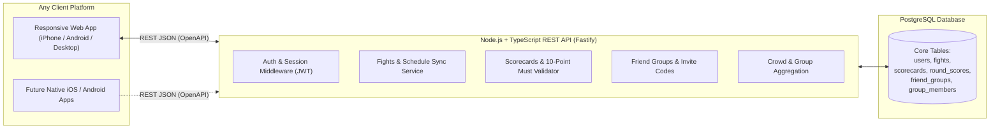

# R2R Scorecards — Codebase Audit & Platform-Agnostic MVP Redesign

## 1. Executive Summary

**R2R Scorecards** was conceived as a boxing scorecard app where fans can score fights round-by-round and compare their cards with friends and the wider crowd.

However, the original implementation suffered from two major issues:
1. **Severe Scope Creep Before MVP:** Instead of shipping a working core loop (browse fight → score rounds → lock scorecard → compare scores), the project expanded into a BoxRec historical database clone, a friend-request social network, demographic analytics breakdowns (by region/age/gender), StoreKit tip jars, custom themes, and 35+ AI-generated status markdown files.
2. **"Split Brain" iOS-Only Architecture:** The app began as an Apple-only **SwiftData + CloudKit** app and started a half-finished migration to **Supabase (PostgreSQL)**. Full Supabase service classes were written (`FightService`, `ScorecardService`, `GroupService`, `RealtimeService`), **but the SwiftUI views were never wired up to them**—leaving the UI reading and writing strictly to local on-device SwiftData.

### The Pivot
We are pivoting R2R Scorecards to an **API-first, platform-agnostic architecture**:
- **Backend API:** **TypeScript + Node.js (Fastify)** exposing a clean, documented REST/OpenAPI contract backed by PostgreSQL. All domain validation (10-Point Must rules, scorecard locking, group invite codes, crowd averages, and external fight schedule syncing) lives in the API so **any platform** (Web, iOS, Android, third-party) can consume it.
- **MVP Client:** A **Responsive Mobile-First Web App** (works immediately on iPhone, Android, and Desktop browsers without App Store friction), while archiving/removing the tangled iOS-only SwiftData codebase.

---

## 2. Audit of the Existing Codebase

### 2.1 Disconnected Dual Backends ("Split Brain")
| Layer | Local / CloudKit Stack (Active in UI) | Supabase Stack (Written but Unused by Core UI) |
|---|---|---|
| **Persistence** | SwiftData `@Model` (`Fight`, `Scorecard`, `RoundScore`, `FriendGroup`, `User`) | `SupabaseModels.swift` (`SBFight`, `SBScorecard`, `SBRoundScore`, `SBFriendGroup`, `SBProfile`) |
| **Services** | Direct `@Query` and `modelContext.insert()` inside SwiftUI views | `FightService.swift`, `ScorecardService.swift`, `GroupService.swift`, `RealtimeService.swift` |
| **Authentication** | `AuthManager.swift` (Sign in with Apple + local `UserDefaults`) | `SupabaseAuthService.swift` (Supabase Auth) wrapped together in `AppAuthState.swift` |
| **Main Views** | `HomeViewEnhanced.swift`, `ImprovedFightDetailView.swift`, `ScorecardView.swift` all query local SwiftData only | Only `UserSearchView.swift` and `FriendRequestsView.swift` talk to Supabase |

### 2.2 Three Competing Fight Data Integrations on the Client
- **`BoxingAPIService.swift`:** Calls RapidAPI (`boxing-data-api.p.rapidapi.com`) directly from the iPhone using a **hardcoded API key** and imports fights into local device SwiftData.
- **`BoxerIndexService.swift`:** Calls TheSportsDB (`thesportsdb.com/api/v1/json/3`) directly from the client.
- **`ESPNFightService.swift` & `FightSource.swift`:** Unfinished stub files committed directly to the repository root (`// TODO: Implement ESPN upcoming fights fetch`).

### 2.3 Pre-MVP Feature Bloat (To Be Cut)
- **BoxRec Encyclopedia Clone (`backend/boxing_index_migration.sql`, `boxing_index_views.sql`, `BoxerSearchView.swift`):** Tracks fighter stance, reach, height, birth city, sanctioning body rankings (`WBC`, `WBA`, `IBF`, `WBO`), and head-to-head career views.
- **Bidirectional Social Graph (`SUPABASE_SOCIAL_SCHEMA.sql`, `FriendRequestService.swift`, `FriendRequestsView.swift`):** Full friend request and friendship management system, duplicating the much simpler fight-specific **6-character group invite code** workflow.
- **Demographic Analytics (`backend/analytics_views.sql`, `GeographicPicker.swift`):** Breaking down scores by age group, gender, and geographic region before having active users.
- **Monetization & Chrome (`StoreKitManager.swift`, `TipJarView.swift`, `ThemeManager.swift`, `OnboardingFlow.swift`, `AnimatedTransitions.swift`):** In-app purchase tip jars, 5 color themes, and settings toggles in `SettingsViewEnhanced.swift` for unimplemented features (punch stats, swipe-to-score, round timers).
- **Duplicate Views & Stray Root Files:**
  - Three competing fight detail views: `FightDetailView.swift`, `ImprovedFightDetailView.swift`, and `ImprovedScoringFlow.swift` (where `startSoloScoring()` ends with `// TODO: Navigate`).
  - Five Swift files (`RootView.swift`, `ESPNFightService.swift`, `FightSource.swift`, `AuthUIState.swift`, `SupabaseAuthService+Restore.swift`) and `project.pbxproj.backup` committed to the root directory.
  - Hardcoded credentials in `SupabaseManager.swift`, `BoxingAPIService.swift`, and `backend/.env` (on `feature/boxing_scraper`).

---

## 3. What We Are Keeping (Core Domain Assets)

1. **Core Relational Data Model (`backend/schema.sql`):**
   - The core 6 tables—`users`/`profiles`, `fights`, `friend_groups`, `group_members`, `scorecards`, and `round_scores`—are clean, normalized, and well-indexed.
   - **Draft vs. Locked Scorecards:** Using `submitted_at` (`NULL` = editable draft, `TIMESTAMP` = locked final scorecard) is a clean state model.
   - **One Scorecard Per Context:** Unique constraint on `(user_id, fight_id, group_id)` (with `NULL`-safe handling for solo scorecards).
   - **6-Character Invite Codes:** Collision-free invite codes using unambiguous characters (`ABCDEFGHJKLMNPQRSTUVWXYZ23456789`).
2. **Queensberry 10-Point Must Scoring Rules (`BoxingRules.swift`):**
   - Scores between `6` and `10` per fighter per round.
   - At least one fighter must score `10` (unless point deductions apply, e.g., `9-9`, `9-8`).
   - Maximum margin of `4` points (`10-6`).
   - Quick presets (`10-9` Red, `9-10` Blue, `10-10` Even) + knockdown/deduction modifiers (`10-8`, `10-7`, point deductions).

---

## 4. Target Architecture: Platform-Agnostic API + Web MVP



### 4.1 Monorepo Directory Structure
```text
r2rscorecards/
├── api/                        # TypeScript + Fastify REST API (platform-agnostic)
│   ├── src/
│   │   ├── config/             # Environment config & validation
│   │   ├── db/                 # PostgreSQL connection & migrations (schema.sql)
│   │   ├── domain/             # Pure boxing rules & scorecard validation (10-Point Must)
│   │   ├── routes/             # REST endpoints (fights, scorecards, groups, auth)
│   │   ├── services/           # Business logic & background fight sync
│   │   └── index.ts            # Fastify server + OpenAPI/Swagger registration
│   ├── tests/                  # Unit & API integration tests
│   └── package.json
├── web/                        # Responsive Mobile-First Web Client (React + TypeScript + Vite)
│   ├── src/
│   │   ├── api/                # Typed API client consuming the REST API
│   │   ├── components/         # Round scorer, scorecard table, crowd comparison
│   │   ├── pages/              # Fight list, Fight detail & live scoring, Group view
│   │   └── main.tsx
│   └── package.json
├── backend/                    # Reference SQL schema
└── docs/                       # Concise architectural & API documentation
```

### 4.2 Core REST API Endpoints (`/api/v1`)

#### Auth & Users
- `POST /api/v1/auth/register` — Register with email, password, and display name
- `POST /api/v1/auth/login` — Authenticate and receive a JWT
- `POST /api/v1/auth/guest` — Instant guest session so users can score a fight immediately with zero friction
- `GET  /api/v1/auth/me` — Current user profile

#### Fights
- `GET  /api/v1/fights` — List fights (`?status=upcoming|inProgress|complete`)
- `GET  /api/v1/fights/:fightId` — Fight details + aggregated crowd score summary
- `POST /api/v1/fights` — Create/import a fight (admin / sync job)
- `PATCH /api/v1/fights/:fightId` — Update fight status or official result

#### Scorecards & Round Scoring
- `GET  /api/v1/fights/:fightId/scorecards/me` — Get current user's scorecard(s) for a fight (`?groupId=optional`)
- `POST /api/v1/fights/:fightId/scorecards` — Create a new draft scorecard (solo or for a `groupId`)
- `PUT  /api/v1/scorecards/:scorecardId/rounds/:round` — Upsert a round score (`redScore`, `blueScore`), validated against 10-Point Must rules; rejected if scorecard is already submitted
- `POST /api/v1/scorecards/:scorecardId/submit` — Validate all scheduled rounds are scored and lock the scorecard (`submitted_at = NOW()`)
- `GET  /api/v1/fights/:fightId/crowd-scores` — Overall crowd averages & per-round consensus from submitted scorecards

#### Friend Groups (Optional Social Layer)
- `POST /api/v1/fights/:fightId/groups` — Create a group for a fight (generates a unique 6-character `inviteCode`)
- `POST /api/v1/groups/join` — Join a group by `inviteCode`
- `GET  /api/v1/groups/:groupId` — Group details, member list, and side-by-side member scorecards / round averages

---

## 5. Implementation Roadmap

### Phase 1: Repository Cleanup & Foundation
- Archive/remove the legacy iOS-only SwiftData/CloudKit codebase, stray root Swift files, `.xcodeproj.backup`, and the 30+ redundant markdown files.
- Clean up `.gitignore` so `.env`, `.DS_Store`, `node_modules`, and build artifacts are never committed.
- Consolidate the PostgreSQL schema into a clean migration strictly covering the MVP tables.

### Phase 2: Platform-Agnostic REST API (`api/`)
- Scaffold the **TypeScript + Fastify** API with automatic **OpenAPI / Swagger UI** (`/docs`).
- Port the **10-Point Must System** (`BoxingRules`) into pure, unit-tested TypeScript domain logic.
- Implement Auth (including frictionless Guest/Quick-Start auth + JWT), Fights, Scorecards, Round Scoring, Crowd Stats, and 6-character Invite Code Groups.
- Include an in-memory / SQLite or PostgreSQL adapter and seed data so the API runs locally with zero external setup required, while supporting production PostgreSQL/Supabase via `DATABASE_URL`.

### Phase 3: Responsive Web Client (`web/`)
- Build a fast, mobile-first Web App (designed to feel great on iPhone Safari, Android Chrome, and Desktop):
  1. **Fights Feed:** Upcoming, Live, and Completed fights + ability to add custom fights.
  2. **Interactive Round Scorer:** One-tap `10-9` Red, `9-10` Blue, `10-10` Even, knockdown/deduction controls, running total badge, and final scorecard lock/submission.
  3. **Crowd & Group Comparison:** View global round-by-round crowd averages or create/join a 6-character group code to compare cards with friends.
